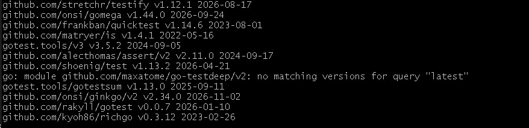
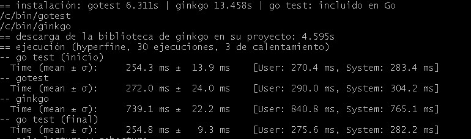
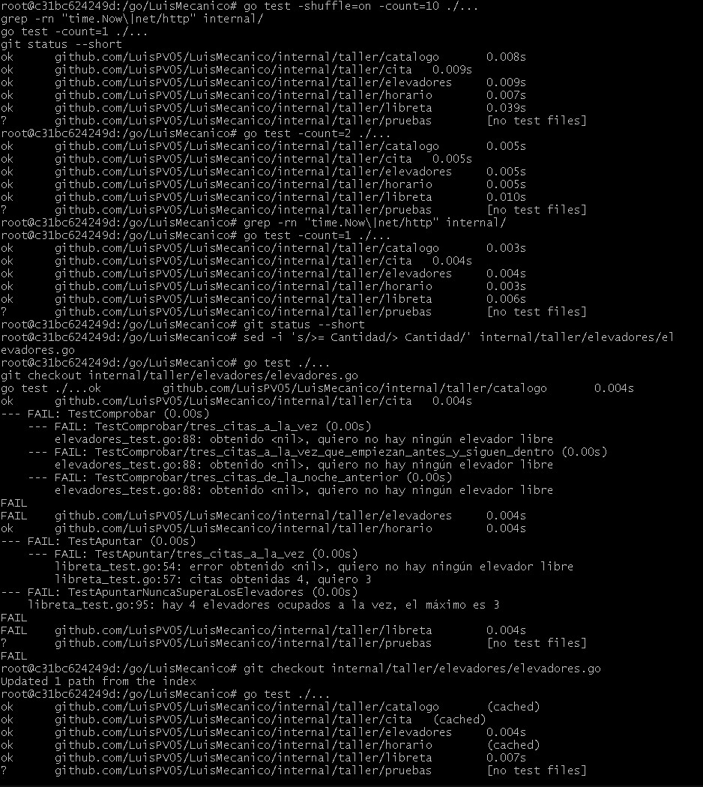

# Objetivo 4: Tests

## Biblioteca de aserciones

### Criterios

Búsqueda: módulos de Go cuya función declarada es comparar resultados en tests, tanto los más usados como alternativas menos conocidas.

Aceptación:
- Mantenimiento: ha publicado versión en el último año.
- Dependencias nuevas que añade a `go.mod` y `go.sum`.
- Coste: tiempo de descarga y compilación, y sobrecarga en la ejecución frente a usar `testing` solo.
- Permite comprobar errores con `errors.Is` y comparar structs y `time.Time`.
- No escribe ficheros junto a los fuentes (lo exige el objetivo 5).

### Opciones

Última versión publicada de cada candidata, obtenida con `go list -m` en Linux (imagen `golang:latest`):

Cumplen el criterio de mantenimiento: `testing` (biblioteca estándar, la referencia), testify v1.12.1 (17-08-2026), gomega v1.44.0 (24-09-2026) y shoenig/test v1.13.2 (21-04-2026).

Se descartan por no cumplirlo: quicktest v1.14.6 (01-08-2023), is v1.4.1 (16-05-2022), gotest.tools/v3 v3.5.2 (05-09-2024) y alecthomas/assert v2.11.0 (17-09-2024). Sin comprobar: go-testdeep, porque `go list` no encuentra versión con la ruta `/v2`.

### Medidas

Un mismo test con cada opción (comparar una estructura con `time.Time` y comprobar un error con `errors.Is`), en Linux (imagen `golang:latest`), con las cachés vacías. Descarga con `go mod tidy`; ejecución con hyperfine sobre el binario de test ya compilado (500 ejecuciones, 20 de calentamiento).

- `testing`: descarga 0,585 s, compilación 6,186 s, 0 módulos, ejecución 2,8 ± 0,4 ms.
- testify: descarga 1,421 s, compilación 11,217 s, 3 módulos, ejecución 3,9 ± 0,6 ms.
- gomega: descarga 2,512 s, compilación 12,283 s, 12 módulos, ejecución 4,4 ± 0,6 ms.
- shoenig/test: descarga 1,104 s, compilación 7,045 s, 2 módulos, ejecución 4,1 ± 0,7 ms.

Las cuatro comprueban errores y estructuras con `time.Time` y pasan con los fuentes en solo lectura. La sobrecarga de ejecución de las tres externas (entre 1,1 y 1,6 ms) queda dentro de la desviación.

### Decisión

Me quedo con `testing`, sin biblioteca externa. Las cuatro cumplen los criterios de aceptación y lo que las separa es el coste: `testing` no añade módulos ni tiempo, y shoenig/test, testify y gomega añaden 2, 3 y 12 módulos y entre 1,4 y 8,0 s. Ninguna aporta algo que mis criterios premien. El precio es escribir las comparaciones a mano.

## Test runner

### Criterios

Búsqueda: programas o módulos de Go que ejecutan los tests y muestran el informe, tanto los más usados como alternativas menos conocidas.

Aceptación:
- Mantenimiento: ha publicado versión en el último año.
- Tiempo de instalación en Linux con el método oficial.
- Sobrecarga de ejecución frente a `go test`.
- Funciona con el directorio de fuentes en solo lectura (lo exige el objetivo 5).
- Informa de tests pasados y fallados, y de cobertura.

### Opciones

Las versiones y fechas salen de la misma captura. Cumplen el mantenimiento: `go test` (incluido en Go, la referencia), ginkgo v2.34.0 (02-11-2026) y gotest v0.0.7 (10-01-2026). Se descartan: gotestsum v1.13.0 (11-09-2025) y richgo v0.3.12 (26-02-2023).

### Medidas

Un mismo test por opción, en Linux (imagen `golang:latest`), instalando con `go install` y cachés vacías. Ejecución con hyperfine (30 ejecuciones, 3 de calentamiento) sobre `go test -count=1 ./...` o el equivalente de cada runner. El solo lectura se prueba como usuario sin permisos de escritura en los fuentes.

- `go test`: sin instalación. Ejecución 254,3 ± 13,9 ms al inicio y 254,8 ± 9,3 ms al final.
- gotest: instalación 6,311 s. Ejecución 272,0 ± 24,0 ms, no distinguible del ruido.
- ginkgo: instalación 13,458 s. Ejecución 739,1 ± 22,2 ms (+484,5 ms).
- Solo lectura: `go test` y gotest pasan. ginkgo falla porque copia el binario de test al directorio del paquete (`permission denied`); compilando el test fuera con `go test -c -o` pasa, pero con dos comandos.
- Informe: `go test` y gotest muestran pasados, fallados y cobertura. La cobertura de ginkgo no se midió, porque falló antes.

### Decisión

Me quedo con `go test`. Cumple los cinco criterios sin instalar nada. gotest cumple lo mismo pero no aporta nada medible. Descarto ginkgo por 13,5 s de instalación, +484,5 ms por ejecución y porque falla con los fuentes en solo lectura, lo que pesa para el objetivo 5.

## Calidad de los tests

### Criterios

El objetivo pide tests sin código repetido, con baja complejidad y sin ficheros enormes. Fijo los límites antes de medir:
- Complejidad ciclomática: 10 por función (el límite de McCabe).
- Longitud de función: 50 líneas. No uso 30 porque los tests con tabla son largos por los datos, no por lógica.
- Longitud de fichero: 300 líneas.
- Código duplicado: ningún bloque en los tests. Las ayudas comunes están en `internal/taller/pruebas`.

Búsqueda: herramientas de Go o genéricas que midan complejidad ciclomática, longitud de funciones y duplicados.

F.I.R.S.T., cada letra con una comprobación:
- Independientes: `go test -shuffle=on -count=10 ./...` pasa.
- Repetibles: `go test -count=2 ./...` pasa, sin `time.Now` ni `net/http` en el código (`grep`) y sin dejar ficheros (`git status`).
- Rápidos: cada paquete tarda menos de 1 s.
- Autovalidables: romper una regla a propósito hace fallar un test.
- Oportunos: en `git log`, el commit de tests va antes que el del código.

### Opciones

Criterio de mantenimiento: un release en el último año (consulta del 23-11-2026), en la captura `calidad-versiones.png`. Cumplen: gocognit (06-10-2026, mide complejidad cognitiva), dupl (04-03-2026), scc (27-02-2026) y golangci-lint v2.15.0 (16-10-2026, incluye `cyclop`, `funlen` y `dupl`). Se descartan por no cumplirlo: gocyclo (15-06-2022) y cyclop suelto (16-10-2024).

### Medidas

Linux (contenedor `golang:latest`, Go 1.27), rama `Objetivo-4`, golangci-lint v2.15.0 instalado con su script oficial, con `cyclop` (10), `funlen` (50) y `dupl` (100 tokens).

- Complejidad, longitud de función y duplicados: `0 issues`.
- Longitud de fichero: el mayor es `cita/cita_test.go` con 134 líneas (16 ficheros `.go`, 890 líneas).
- Independientes: 10 de 10 en `ok` con `-shuffle=on`.
- Repetibles: 2 de 2 en `ok`; `grep` sin resultados; `git status` vacío.
- Rápidos: entre 0,003 s y 0,039 s por paquete.
- Autovalidables: al cambiar `>=` por `>` en `elevadores.go` fallan `TestComprobar`, `TestApuntar` y `TestApuntarNuncaSuperaLosElevadores`; al restaurar, `ok`.
- Oportunos: en cada paquete el commit de tests precede al del código (por ejemplo `1b6f06f` antes de `b099e30` en `horario`).

### Decisión

Uso golangci-lint (v2.15.0) con `cyclop`, `funlen` y `dupl`, y los límites fijados antes de medir. Con una instalación y un comando mide tres criterios; las alternativas mantenidas obligan a usar una herramienta por criterio, y gocognit mide otra complejidad. Se instala con su script de binarios, sin añadir dependencias a `go.mod`. La longitud de fichero se comprueba con `wc -l` y F.I.R.S.T. con `go test`, `grep` y `git log`. Los límites no se relajan para que pasen.

## Producto mínimo viable (PMV)

El PMV es el Milestone 1: apuntar una cita cumpliendo todas las reglas de HU001, detectando el conflicto al organizar la cita y no cuando empieza la reparación.

Paquetes del PMV, cada uno con sus tests: `horario` (horario y jornada), `catalogo` (tipos de reparación), `cita`, `elevadores` y `libreta` (punto de entrada: `Libreta.Apuntar`).

### Tests que debe pasar

El PMV está terminado cuando `just test` pasa y estos comportamientos tienen test:
- Apuntar en una libreta vacía añade la cita.
- Una cita en domingo se rechaza (`ErrDomingo`).
- Una cita fuera de las 8:00 a 21:00 se rechaza (`ErrFueraDeHorario`).
- Un tipo que no está en el catálogo se rechaza (`ErrTipoDesconocido`).
- Una cita con el mismo inicio y tipo que otra se rechaza (`ErrCitaDuplicada`).
- Con los tres elevadores ocupados a la vez, una cita que necesita elevador se rechaza (`ErrSinElevadorLibre`).
- Con los tres elevadores ocupados, una cita que no usa elevador se apunta.
- Una reparación larga sigue en la siguiente jornada y se salta el domingo.
- Tras cualquier secuencia de citas, nunca hay más de tres elevadores ocupados a la vez.
- Rechazar una cita no cambia la libreta.

### Niveles de test

- Unitarios: funciones puras de cada paquete, con tablas de casos.
- Integración: `Libreta.Apuntar` junta las reglas de todos los paquetes, y `catalogo.Cargar` se prueba contra el fichero real `tipos_reparacion.csv`.
- De propiedad: una secuencia larga de citas comprueba que nunca se superan los tres elevadores.
- No hay tests de interfaz ni de extremo a extremo: el PMV no tiene interfaz.