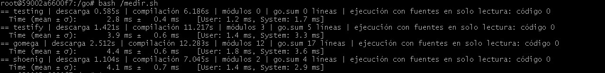
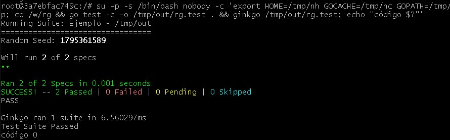
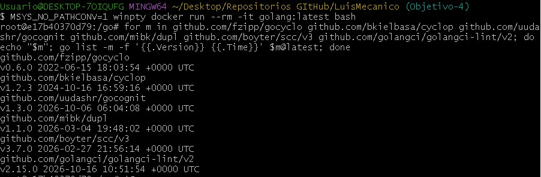
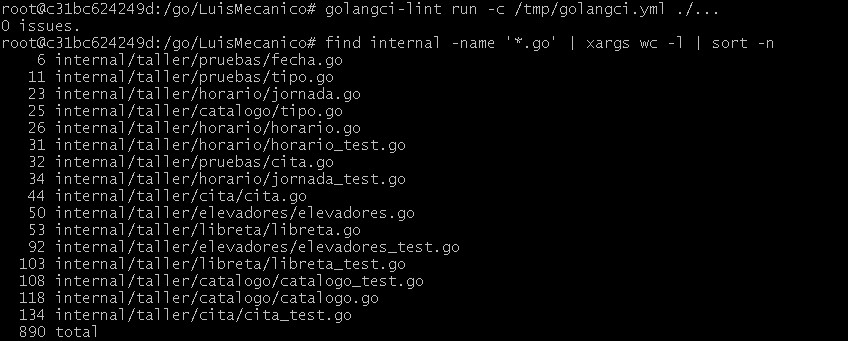
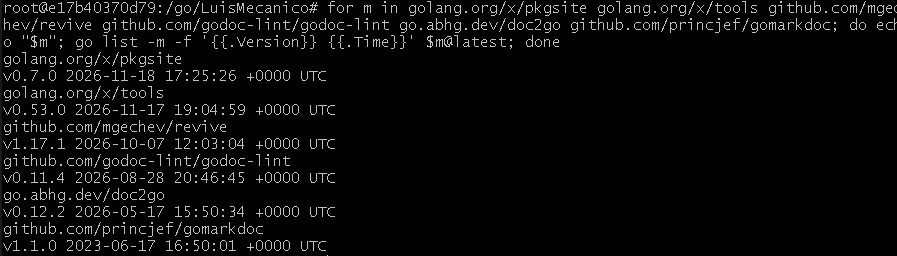

# Objetivo 4: Tests

Una biblioteca de aserciones compara el resultado obtenido con el esperado y da el mensaje del fallo. Un test runner descubre los tests, los ejecuta y produce el informe de pasados, fallados y cobertura.

## Biblioteca de aserciones

### Criterios

- Mantenimiento: ha publicado versión en el último año.
- Dependencias nuevas que añade a `go.mod` y `go.sum`.
- Coste: tiempo de descarga y compilación, y sobrecarga en la ejecución frente a usar `testing` solo.
- Permite comprobar errores con `errors.Is` y comparar structs y `time.Time`.
- No escribe ficheros junto a los fuentes (lo exige el objetivo 5).

### Opciones

Última versión publicada de cada candidata, obtenida con `go list -m` en Linux (imagen `golang:latest`):

Cumplen el criterio de mantenimiento:

- `testing`, de la biblioteca estándar de Go. Es la referencia con la que se compara.
- testify v1.12.1 (17-08-2026).
- gomega v1.44.0 (24-09-2026).
- shoenig/test v1.13.2 (21-04-2026).

No lo cumplen y se descartan:

- quicktest v1.14.6 (01-08-2023).
- is v1.4.1 (16-05-2022).
- gotest.tools/v3 v3.5.2 (05-09-2024).
- alecthomas/assert v2.11.0 (17-09-2024).

Sin comprobar: go-testdeep, porque `go list` no encuentra versión con la ruta `/v2`.

### Medidas

Un mismo test escrito con cada opción (comparar una estructura con `time.Time` y comprobar un error con `errors.Is`), en Linux (imagen `golang:latest`), con las cachés de módulos y de compilación vacías en cada una. La descarga es `go mod tidy`; la ejecución se mide con hyperfine sobre el binario de test ya compilado (500 ejecuciones, 20 de calentamiento).

- `testing`: descarga 0,585 s, compilación 6,186 s, 0 módulos, 0 líneas en `go.sum`, ejecución 2,8 ± 0,4 ms.
- testify: descarga 1,421 s, compilación 11,217 s, 3 módulos, 5 líneas en `go.sum`, ejecución 3,9 ± 0,6 ms.
- gomega: descarga 2,512 s, compilación 12,283 s, 12 módulos, 17 líneas en `go.sum`, ejecución 4,4 ± 0,6 ms.
- shoenig/test: descarga 1,104 s, compilación 7,045 s, 2 módulos, 4 líneas en `go.sum`, ejecución 4,1 ± 0,7 ms.

Resultado por criterio:

- Errores y estructuras: las cuatro compilan y pasan el test.
- Escritura junto a los fuentes: las cuatro pasan con los fuentes en solo lectura, ejecutadas como usuario sin permisos de escritura.
- Dependencias nuevas: testify 3 módulos, gomega 12, shoenig/test 2.
- Coste de descarga y compilación frente a `testing`: testify +5,9 s, gomega +8,0 s, shoenig/test +1,4 s.
- Sobrecarga de ejecución frente a `testing`: testify +1,1 ms, gomega +1,6 ms, shoenig/test +1,3 ms. Las diferencias entre las tres están dentro de la desviación.

### Decisión

Me quedo con `testing`, sin biblioteca externa.

Las cuatro opciones cumplen mantenimiento, comprobar errores con `errors.Is`, comparar estructuras con `time.Time` y no escribir junto a los fuentes. Lo que las separa es el coste: `testing` no añade ningún módulo ni tiempo de descarga o compilación, mientras que shoenig/test añade 2 módulos y 1,4 s, testify 3 módulos y 5,9 s y gomega 12 módulos y 8,0 s. La sobrecarga de ejecución (entre 1,1 y 1,6 ms) queda dentro de la desviación y no desempata.

Descarto shoenig/test, testify y gomega porque ninguna aporta algo que mis criterios premien y todas añaden dependencias y tiempo. El precio de `testing` es escribir las comparaciones a mano, que mis criterios no medían.

## Test runner

### Criterios

- Mantenimiento: ha publicado versión en el último año.
- Tiempo de instalación en Linux con el método oficial.
- Sobrecarga de ejecución frente a `go test`.
- Funciona con el directorio de fuentes en solo lectura (lo exige el objetivo 5).
- Informa de tests pasados y fallados, y de cobertura.

### Opciones

Las versiones y fechas salen de la misma captura.

Cumplen el criterio de mantenimiento:

- `go test`, incluido en Go. Es la referencia con la que se compara.
- ginkgo v2.34.0 (02-11-2026).
- gotest v0.0.7 (10-01-2026).

No lo cumplen y se descartan:

- gotestsum v1.13.0 (11-09-2025).
- richgo v0.3.12 (26-02-2023).

### Medidas

Un mismo test escrito para cada opción, en Linux (imagen `golang:latest`). La instalación se hace con `go install` y las cachés vacías. La ejecución se mide con hyperfine (30 ejecuciones, 3 de calentamiento) sobre `go test -count=1 ./...`, o el comando equivalente de cada runner, con la compilación ya en caché; `go test` se mide al principio y al final para detectar deriva de la máquina. El solo lectura se prueba ejecutando como un usuario sin permisos de escritura en el directorio de los fuentes, con la caché de compilación en otro sitio. La variante de ginkgo usa su propio estilo de tests (`Describe` e `It`).

- `go test`: incluido en Go. Ejecución 254,3 ± 13,9 ms al inicio y 254,8 ± 9,3 ms al final (referencia: 254,6 ms).
- gotest: instalación 6,311 s. Ejecución 272,0 ± 24,0 ms.
- ginkgo: instalación 13,458 s, más 4,595 s de descarga de su biblioteca en el proyecto. Ejecución 739,1 ± 22,2 ms.

Resultado por criterio:

- Instalación: `go test` ninguna; gotest 6,3 s; ginkgo 13,5 s.
- Sobrecarga de ejecución frente a `go test`: gotest +17,4 ms, dentro de su desviación y por tanto no distinguible del ruido; ginkgo +484,5 ms.
- Solo lectura: `go test` y gotest pasan (código 0). `ginkgo` falla (código 1), con y sin `--output-dir`, porque copia el binario de test compilado al directorio del paquete (`permission denied`). Compilando el test fuera con `go test -c -o` y pasándole el binario a ginkgo, pasa (código 0), pero son dos comandos.
- Informe: `go test` y gotest muestran tests pasados y fallados y el porcentaje de cobertura (100 % en esta prueba); ginkgo muestra specs pasados y fallados. La cobertura de ginkgo no se midió, porque falló antes por el solo lectura.

### Decisión

Me quedo con `go test`.

Cumple los cinco criterios: viene con Go sin instalar nada, muestra tests pasados, fallados y cobertura, y pasa con los fuentes en solo lectura. gotest cumple lo mismo, pero no aporta nada medible: tarda 6,3 s en instalarse y su sobrecarga (+17,4 ms) queda dentro de la desviación. Descarto ginkgo porque tarda 13,5 s en instalarse, añade +484,5 ms por ejecución y falla con los fuentes en solo lectura salvo que se compile el test fuera, lo que obliga a usar dos comandos. Esto último pesa para el objetivo 5.

## Calidad de los tests

El objetivo pide tests sin código repetido, con baja complejidad y sin ficheros enormes. Sin límites medibles, "está bien escrito" es una opinión, así que fijo los límites antes de medir y los justifico.

### Criterios

| Criterio | Límite | Cómo se comprueba |
|---|---|---|
| Complejidad ciclomática | 10 por función | herramienta de análisis estático |
| Longitud de función | 50 líneas | herramienta de análisis estático |
| Longitud de fichero | 300 líneas | `wc -l` sobre los ficheros `.go` |
| Código duplicado | ningún bloque en los tests | herramienta de análisis estático |
| Independientes | pasan en orden aleatorio | `go test -shuffle=on -count=10 ./...` |
| Repetibles | pasan dos veces seguidas, sin red ni reloj | `go test -count=2 ./...` y `grep -rn "time.Now\|net/http" internal/` sin resultados |
| Rápidos | todo el conjunto en menos de 1 s | tiempo que imprime `go test ./...` |
| Autovalidables | romper una regla hace fallar un test | cambio a propósito en el código y `go test ./...` en rojo |
| Oportunos | el test se escribe antes que el código | en `git log`, el commit de tests va antes que el del código |

### Por qué estos límites

- **Complejidad 10.** Es el límite que propuso McCabe al definir la métrica y el que suelen usar las herramientas. Una función con más caminos es difícil de probar entera y de entender. El código del taller usa funciones puras pequeñas, así que es un límite alcanzable.
- **50 líneas por función.** Cabe en una pantalla. No uso 30 porque los tests con tabla son largos solo por los datos de los casos, no por lógica, y con 30 fallarían sin estar mal escritos.
- **300 líneas por fichero.** Obliga a separar por responsabilidad, como ya se hace (`cita.go`, `horario.go`, `jornada.go`, `elevadores.go`), y evita ficheros enormes.
- **Sin duplicados.** Si el mismo bloque aparece varias veces en los tests, un cambio en la regla obliga a tocar muchos sitios. Se resuelve con funciones auxiliares (`fecha`, `citaDe`, `citasALaVez`) y tests con tabla.
- **F.I.R.S.T.** Cada letra tiene una comprobación concreta y automática. Independientes y repetibles aseguran que un test no depende del orden, de la red ni de la hora. Rápidos hace que se ejecuten siempre. Autovalidables evita tests que pasan aunque el código esté roto. Oportunos hace que los tests guíen el diseño (TDD).

### Opciones

Busco herramientas que midan los límites de arriba. Criterio de mantenimiento: al menos un release en el último año (fecha de consulta: 23/11/2026).

| Herramienta | Qué mide | Último release | Mantenida |
|---|---|---|---|
| gocyclo | complejidad ciclomática | 2022-06-15 | no |
| cyclop | complejidad ciclomática | 2024-10-16 | no |
| gocognit | complejidad cognitiva | 2026-10-06 | sí |
| dupl | código duplicado | 2026-03-04 | sí |
| scc | líneas por fichero | 2026-02-27 | sí |
| golangci-lint | agrupa varios analizadores (entre ellos cyclop, funlen y dupl) | 2026-10-16 | sí |

`gocyclo` y `cyclop` quedan descartadas como programas sueltos por no tener release en el último año. `gocognit` mide complejidad cognitiva, que no es el criterio fijado (ciclomática).

### Medidas

Medido en Linux (contenedor `golang:latest`, Go 1.27), sobre la rama `Objetivo-4`. golangci-lint v2.15.0, instalado con su script oficial de binarios, con `cyclop` (10), `funlen` (50 líneas) y `dupl` (umbral de 100 tokens).

| Criterio | Límite | Medido | ¿Cumple? |
|---|---|---|---|
| Complejidad ciclomática | 10 | ninguna función lo supera (`0 issues`) | sí |
| Longitud de función | 50 líneas | ninguna lo supera (`0 issues`) | sí |
| Longitud de fichero | 300 líneas | máximo 118 (`catalogo.go`) | sí |
| Código duplicado | ninguno | ninguno (`0 issues`) | sí |
| Independientes | 10 pasadas en orden aleatorio | 10 de 10 en `ok` | sí |
| Repetibles | 2 pasadas, sin red ni reloj | 2 de 2 en `ok`; `grep` sin resultados; `git status` vacío | sí |
| Rápidos | menos de 1 s | entre 0,019 s y 0,101 s | sí |
| Autovalidables | romper una regla hace fallar un test | al cambiar `>=` por `>` en `elevadores.go` fallan `TestApuntar`, `TestApuntarNuncaSuperaLosElevadores` y `TestComprobarElevador`; al restaurar, `ok` | sí |
| Oportunos | test antes que código | en cada regla, el commit de tests precede al de su código | sí |

Sobre oportunos: `d26804c` (`ocupaElevadorEn`) solo extrae código que ya cubrían los tests de #35, y `apuntar.go` tiene dos commits porque la segunda versión simplifica la primera, ambas después de sus tests.

### Decisión

Uso **golangci-lint** (v2.15.0) con los analizadores `cyclop`, `funlen` y `dupl`, y los límites fijados antes de medir: complejidad 10, función 50 líneas, duplicados con umbral de 100 tokens. La longitud de fichero (300 líneas) se comprueba con `wc -l`, y F.I.R.S.T. con `go test`, `grep` y `git log`.

Por qué:
- Con una sola instalación y un solo comando mide tres de los criterios (complejidad, longitud de función y duplicados). Las alternativas mantenidas (`gocognit`, `dupl`, `scc`) obligan a instalar y ejecutar cada una por separado, y `gocognit` mide complejidad cognitiva, no la ciclomática que fijé.
- Se mantiene: último release el 16/10/2026. `gocyclo` y `cyclop` sueltos están descartados por no tener release en el último año.
- Se instala con el script de binarios de su documentación, sin añadir dependencias al módulo de Go.
- La medida dio `0 issues` con los límites fijados, así que el código actual los cumple sin tener que cambiar ningún límite.

Lo que no cubre: golangci-lint no mide la longitud de fichero, por eso uso `wc -l`. Los límites no se relajan para que pasen: si algún día una función los supera, se divide la función.

## Documentación del código

Los tipos y funciones exportados no están documentados. La documentación se genera desde el código y no se escribe a mano, para que no se desincronice.

### Criterios

| Criterio | Límite | Cómo se comprueba |
|---|---|---|
| Identificadores exportados con comentario de documentación | 100 % | herramienta de análisis estático |
| Cada comentario empieza por el nombre del identificador | 100 % | herramienta de análisis estático |
| Los comentarios describen qué recibe, qué devuelve y qué errores, no cómo lo hace | revisión del contenido | lectura de la documentación generada |
| La documentación se genera con una herramienta | un comando que la produce desde el código | ejecución en Linux |

### Por qué estos límites

- **100 %.** El taller expone pocos identificadores (`Libreta`, `Cita`, `TipoReparacion`, `Apuntar` y los errores). Con tan pocos, dejar uno sin documentar es un descuido, no una carga.
- **Empieza por el nombre.** Es la convención de Go, y las herramientas que generan la documentación la esperan.
- **Qué y no cómo.** Un comentario que explica la implementación se queda viejo cuando cambia el código. El contrato cambia menos.
- **Generada.** Si la documentación sale del código, no puede contradecirlo.

### Convivencia con la regla de no comentar el código

Dentro de las funciones no hay comentarios. Los únicos comentarios son los de documentación, justo encima de cada identificador exportado, y describen el contrato, no la implementación.

### Opciones

Criterio de mantenimiento: al menos un release en el último año (fecha de consulta: 23/11/2026).

| Herramienta | Para qué | Último release | Mantenida |
|---|---|---|---|
| go doc | genera la documentación en texto desde los comentarios; viene con Go | incluida en Go 1.27 | sí |
| pkgsite | genera la documentación como web local, la misma que muestra pkg.go.dev | 2026-11-18 | sí |
| doc2go | genera la documentación como HTML estático | 2026-05-17 | sí |
| revive | comprueba que los exportados tienen comentario con la forma correcta | 2026-10-07 | sí |
| godoc-lint | comprueba la forma de los comentarios de documentación | 2026-08-28 | sí |
| gomarkdoc | genera la documentación en Markdown | 2023-06-17 | no |

`gomarkdoc` queda descartada por no tener release en el último año. `godoc` no se incluye: la fecha de su módulo, `golang.org/x/tools`, es la de todo el módulo y no demuestra que `godoc` se mantenga.

### Medidas antes de documentar

Medido en Linux (contenedor `golang:latest`, Go 1.27) sobre `internal/taller`. revive v1.17.1, instalado con `go install`, con la regla `exported`.

| Criterio | Límite | Medido | ¿Cumple? |
|---|---|---|---|
| Exportados con comentario de documentación | 100 % | 0 de 8 declaraciones (15 identificadores) | no |
| Comentario empieza por el nombre | 100 % | no hay comentarios | no |
| Documentación generada | un comando | `go doc -all ./internal/taller` muestra los nombres sin descripción | no |

Los 15 identificadores exportados son los 11 errores, `Cita`, `Libreta`, `TipoReparacion` y `Libreta.Apuntar`. revive cuenta por declaración, y un bloque `var (...)` cuenta como una.

`godoc-lint` queda descartada como comprobador: `go install` no encontró el paquete en el módulo y no la pude instalar. revive cubre los mismos criterios.